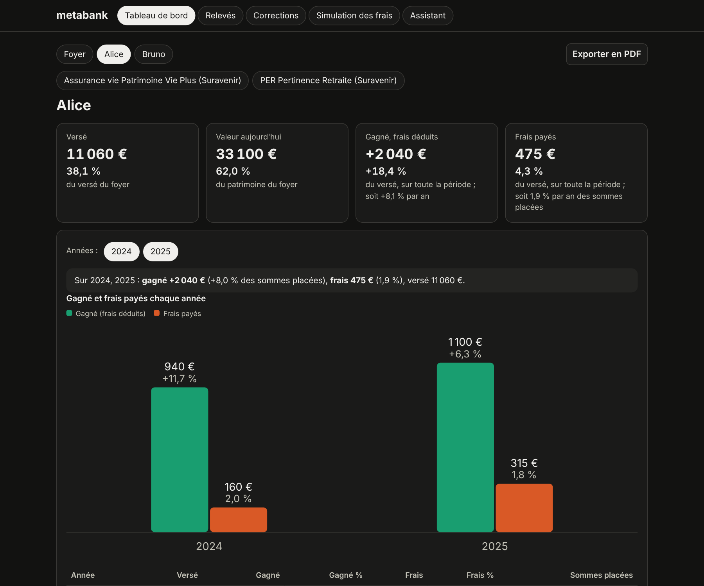
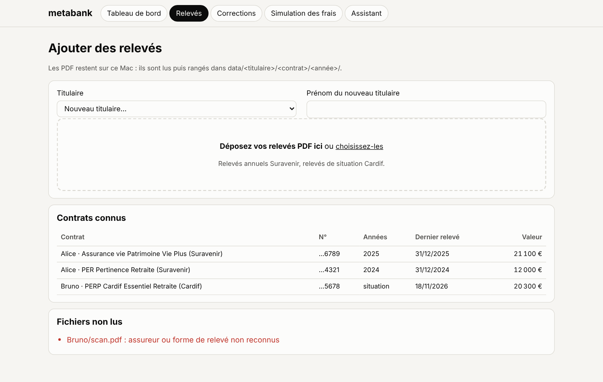
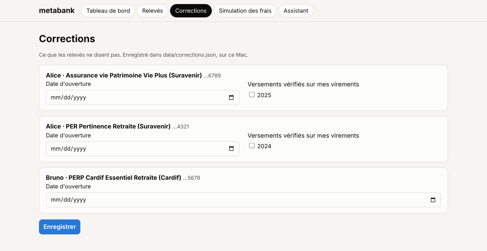
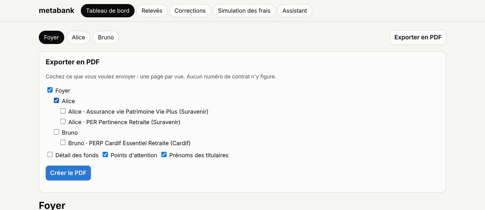
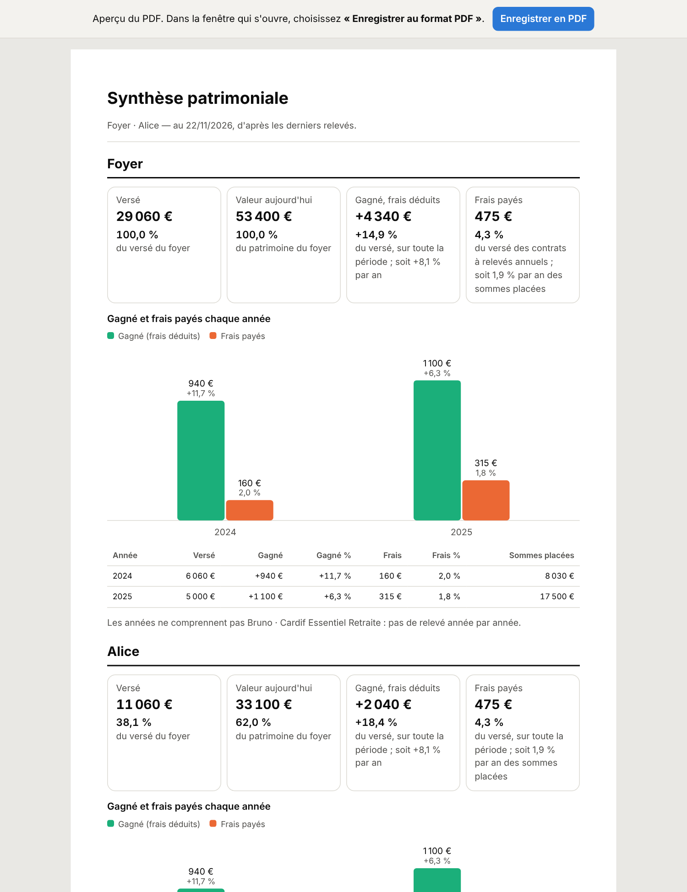

# metabank

Vision globale et analyse du patrimoine financier d'un foyer — assurance vie, PER, PERP — **en local, sans
abonnement**. metabank lit les relevés PDF des assureurs, calcule ce que chaque contrat a réellement rapporté et
coûté, en euros et en pourcentage, et l'affiche dans une application web qui tourne sur votre Mac.

**Lecture seule : aucun virement, ordre ni arbitrage n'est jamais passé.** Les données restent sur la machine.


*Captures réalisées avec des données fictives (Alice et Bruno).*

## Ce que fait metabank

- **Tableau de bord** par foyer, par personne et par contrat : versé, valeur, gagné (frais déduits) et frais
  payés, chacun en euros et en pourcentage ; gagné et frais année par année, avec le choix des années.
- **Relevés** : on dépose les PDF dans la page ; ils sont lus, contrôlés et rangés dans `data/`.
- **Corrections** : dates d'ouverture des contrats, versements vérifiés sur ses virements.
- **Simulation des frais** : valeur dans N ans avec les frais actuels et avec des frais plus bas.
- **Export PDF** : tout ou partie des synthèses, une page A4 par vue, prénoms masquables.
- **Assistant** : questions en français à Claude Code installé sur le Mac, sur les chiffres déjà calculés.

Assureurs reconnus : relevés annuels **Suravenir** (assurance vie, PER), relevés de situation **Cardif** (PERP).
Toutes les formules sont écrites dans [docs/MODELE.md](docs/MODELE.md).

## Installer et lancer

Prérequis sur Mac :

```sh
brew install uv poppler
```

Puis double-clic sur `lancer.command` dans le Finder, ou :

```sh
./lancer.command
```

L'application s'ouvre dans le navigateur sur http://127.0.0.1:8770. Elle n'est joignable que depuis ce Mac ;
fermer la fenêtre du Terminal l'arrête. Commande équivalente : `uv run python -m metabank web`.

## Les écrans

### Tableau de bord

Les puces choisissent le foyer, une personne, puis un de ses contrats. Le survol du graphique détaille l'année ;
le tableau dessous reprend versé, gagné, frais et sommes placées. Thème clair ou sombre selon le Mac.



### Relevés

Déposer les PDF dans la zone : chacun est lu, puis rangé dans `data/<titulaire>/<contrat>/<année>/`. Un PDF non
reconnu est refusé ; un PDF déjà présent n'est pas copié deux fois.



### Corrections

Ce que les relevés ne disent pas : la date d'ouverture d'un contrat (pour le rendement de la première année) et
les années dont on a vérifié les versements sur ses virements, quand deux tableaux d'un même relevé se
contredisent. Enregistré dans `data/corrections.json`.



### Simulation des frais

Deux courbes : la valeur du contrat avec ses frais actuels et avec des frais visés, sans nouveau versement.
Pour un contrat, les frais réels et ceux d'une version en fonds peu chers sont préremplis. Le rendement est une
hypothèse, pas une prévision.


### Export PDF

« Exporter en PDF » : cocher les vues, les options (détail des fonds, points d'attention, prénoms), puis
« Créer le PDF ». L'aperçu A4 s'ouvre ; choisir « Enregistrer au format PDF » dans la fenêtre d'impression.





### Assistant

Questions en français sur ses chiffres. Il faut [Claude Code](https://claude.ai/code) installé sur le Mac.
Claude reçoit les chiffres calculés par metabank et les prénoms, jamais un numéro de contrat ni un relevé ; il
tourne sans outil, dans un dossier vide. Le texte exact envoyé est affiché sous la zone de question.


## Ranger les relevés à la main

Sans passer par la page, on peut aussi ranger les PDF directement :

```
data/<titulaire>/<type> - <assureur> - <contrat> <numéro>/<année>/<relevé>.pdf
```

Types reconnus par le préfixe du dossier : `AV`, `PER`, `PERP`, `PEA`, `CTO`.

## Ligne de commande

```sh
uv run python -m metabank bilan
```

Bilan texte par contrat, et détail dans `data/bilan.json`.

```sh
uv run python -m metabank frais
```

Frais fonds par fonds, y compris ceux déjà déduits des cours, et simulation de fonds moins chers. Options :
`--cible 0.20` (frais d'un fonds peu cher, en %), `--rendement 5`, `--horizon 15`.

```sh
uv run python -m metabank tableau
```

Ancien tableau de bord en une page HTML autonome, `data/tableau.html`.

## Données et confidentialité

- Tout est dans `data/` : relevés, corrections, sorties. Ce dossier n'est **jamais versionné** ; c'est lui qu'il
  faut sauvegarder.
- Le serveur n'écoute que sur 127.0.0.1 et refuse les requêtes venues d'une autre page du navigateur.
- Aucune ressource n'est chargée depuis Internet ; seules les questions à l'assistant sortent du Mac, sans
  numéro de contrat.
- Les chiffres viennent du code testé (`uv run pytest`) ; l'assistant les commente, il n'en calcule pas.
- Éléments d'aide à la décision, pas un conseil financier.

## Wealthfolio (optionnel)

Le déploiement de [Wealthfolio](https://github.com/wealthfolio/wealthfolio) par Docker reste disponible
(`compose.yml`), pour un suivi de portefeuille boursier : prérequis `brew install argon2 openssl` et Docker
Desktop, puis `./outils/lancer_wealthfolio.command`. Sur le NAS : `./outils/preparer_env.sh reseau`.

## Développement

```sh
uv run pytest -q
uv run ruff check
uv run ruff format
```

Plan et jalons : [docs/PLAN.md](docs/PLAN.md). Consignes du projet : [CLAUDE.md](CLAUDE.md).
