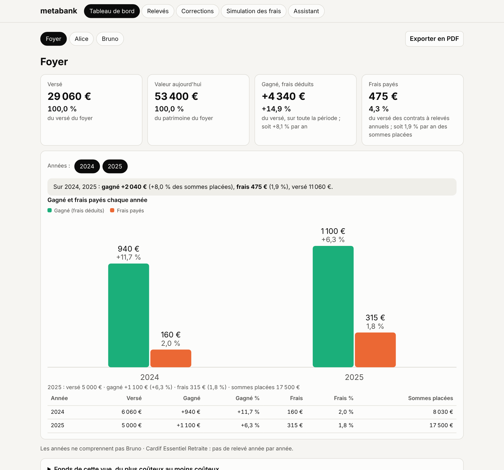
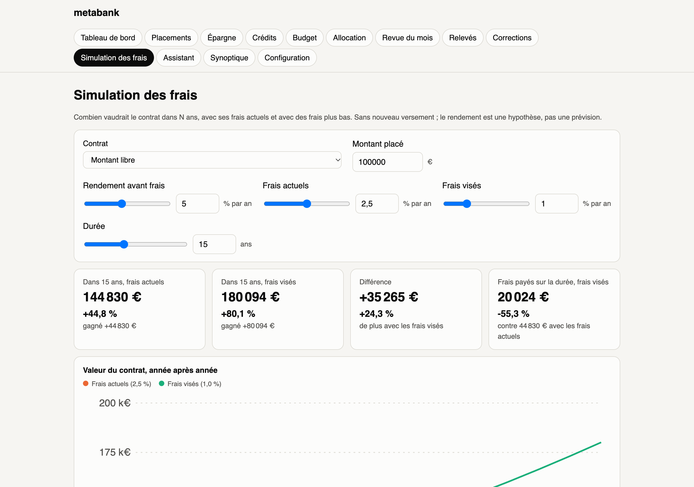
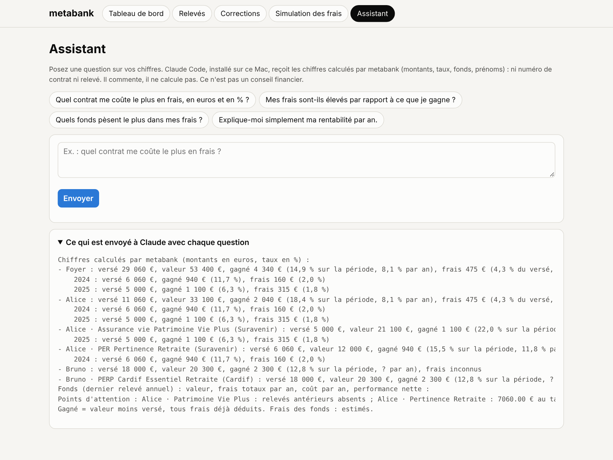

# metabank

Vision globale et analyse du patrimoine financier d'un foyer — assurance vie, PER, PERP, livrets, comptes
courants, crédits immobiliers, bien locatif — **en local, sans abonnement**. metabank lit les relevés PDF des
assureurs, les exports CSV de la banque et, si on le souhaite, les comptes BNP en connexion directe (DSP2). Il
montre ce que chaque contrat vaut et a rapporté, ce que coûte le budget du foyer et ce qui reste dû sur les
crédits, dans une application web qui tourne sur votre Mac.

**Lecture seule : aucun virement, ordre ni arbitrage n'est jamais passé.** Les données restent sur la machine.



*Captures réalisées avec des données fictives (Alice et Bruno), avant la séparation en onglets de la v0.5.0.*

## Le principe : le document de l'assureur fait foi

Chaque PDF de contrat est lu par son lecteur, et ce qu'il dit est écrit dans une **fiche CSV**,
`metabank-<année>.csv`, rangée à côté des PDF : une par contrat et par année. L'application ne lit que ces fiches.

- La fiche s'ouvre dans Excel ou Numbers (séparateur « ; », virgule décimale, dates JJ/MM/AAAA). Chaque ligne
  donne un chiffre lu et le PDF d'où il vient : synthèse du document, fonds détenus, frais des fonds, historique des
  opérations, remarques du lecteur.
- Une fiche existante **n'est jamais réécrite** : une correction faite à la main y reste et l'application la
  reprend. Un nouveau PDF du dossier y est ajouté à la fin. Le bouton **« Relire les PDF »** (onglet Relevés)
  réécrit toutes les fiches depuis les PDF.
- Les chiffres affichés sont ceux de la **synthèse du document** (valeur, cumul des versements, performance
  annoncée). metabank les **contrôle** en refaisant le calcul année par année depuis les opérations, et n'affiche
  l'écart que s'il y en a un. Un chiffre que le document n'imprime pas est calculé et marqué « calculé ».

Format et règles : [docs/MODELE.md § 0](docs/MODELE.md). Toutes les formules sont dans ce fichier.

## Installer et lancer

Prérequis sur Mac :

```sh
brew install uv poppler
```

Puis double-clic sur `lancer.command` dans le Finder, ou :

```sh
./lancer.command
```

L'application s'ouvre dans le navigateur sur http://127.0.0.1:8770. Elle n'est joignable que depuis ce Mac ;
fermer la fenêtre du Terminal l'arrête. Commande équivalente : `uv run python -m metabank web`.

Au premier lancement après une mise à jour qui améliore un lecteur, la base se refait depuis les archives : la
première page prend quelques secondes de plus.

## Les onglets

Les puces en haut choisissent le foyer ou une personne ; elles valent pour le tableau de bord et les onglets de
catégorie. Thème clair ou sombre selon le Mac.

### Tableau de bord

La synthèse : patrimoine net, actifs, une tuile par famille (placements, épargne disponible, comptes courants,
immobilier, crédits) — un clic ouvre l'onglet qui la détaille —, la répartition, la courbe du patrimoine en fin de
mois sur 13 mois et les points d'attention. La liste de tous les comptes est repliée.

### Placements

Assurance vie, PER, PERP. En haut : versé, valeur, gagné et frais, et la valeur des placements en fin d'année.
Puis **une carte par contrat** : la synthèse de son document le plus récent (valeur, cumul des versements, cumul des
rachats, performance annoncée), le nom de la fiche et du PDF lus, le contrôle seulement en cas d'écart, puis ses
années (valeur au 31/12, versé, frais, gagné). Les puces de contrat descendent à un seul contrat. Repliés en bas :
le rendement de chaque année face aux repères publics, les fonds du plus coûteux au moins coûteux, les échéances
(8 ans des assurances vie, transfert des PER, 31 décembre).

Entre deux relevés annuels, une **situation Suravenir** (« Situation de votre contrat au… ») donne la valeur du
jour et l'année en cours ; son historique des opérations sert au versé de l'année et aux coupons reçus.

### Épargne, Crédits, Bien locatif

- **Épargne** : livrets, intérêts attendus, plafonds.
- **Crédits** : capital restant dû projeté au mois en cours, taux, mensualité, fin, intérêts et assurance restants,
  tableau d'amortissement, et « rembourser par anticipation ou placer ? ».
- **Bien locatif** : loyers, charges, rendements brut et net, trésorerie mensuelle.

Un onglet sans donnée pour le foyer est masqué ; vide pour la personne choisie, il le dit.

### Budget

Les comptes courants un par un : solde au fil du temps, entrées et sorties par mois, dépenses par catégorie,
dépenses régulières, objectifs par catégorie, comparaison d'une année sur l'autre, frais bancaires et argent qui
dort. Les virements entre ses propres comptes et vers ses placements ne comptent pas comme des dépenses. Les
dépenses non classées se rangent depuis la page ; les règles de classement se gèrent dans l'onglet.

### Allocation

Répartition du patrimoine financier par classe (choisie ou déduite du libellé du fonds), concentration au-delà de
20 %, cible et versements de rééquilibrage sans rien vendre. Fonds par fonds : prix de revient, plus-value latente,
coupons reçus, et alerte quand un coupon attendu n'est pas venu. Simulateur d'arbitrage : effet des frais d'un
fonds à l'autre.

### Revue du mois

Une liste d'actions datées, imprimable, gardée dans `data/revues/AAAA-MM.md`.

### Relevés

Déposer les PDF et les exports CSV dans la zone : chacun est lu, puis rangé dans
`data/<titulaire>/<contrat>/<année>/` (relevés d'assureur) ou dans le dossier du compte (exports BNP, obtenus par
« Télécharger mes opérations »). Un fichier d'un compte déjà connu se range seul ; un dossier surveillé
(onglet Configuration) peut recevoir les fichiers sans passer par la page. Un fichier non reconnu est refusé ; un
fichier déjà présent n'est pas copié deux fois. Le bouton « Relire les PDF » réécrit les fiches CSV.


### Corrections

Ce que les relevés ne disent pas : la date d'ouverture d'un contrat (pour le rendement de la première année),
les années dont on a vérifié les versements sur ses virements, et la valeur estimée d'un bien financé par un crédit
(pour le patrimoine net). Enregistré dans `data/corrections.json`.


### Simulation des frais et retraite

Valeur d'un contrat dans N ans avec ses frais actuels et avec des frais visés ; projection du capital des PER et
PERP au départ en retraite, en trois scénarios, en euros d'aujourd'hui. Les rendements sont des hypothèses, pas des
prévisions.



### Assistant

Questions en français sur ses chiffres. Il faut [Claude Code](https://claude.ai/code) installé sur le Mac.
Claude reçoit les chiffres calculés par metabank et les prénoms, jamais un numéro de contrat ni un relevé ; il
tourne sans outil, dans un dossier vide. Le texte exact envoyé est affiché sous la zone de question.



### Synoptique et Configuration

- **Synoptique** : fraîcheur de chaque compte (dernière donnée, dernière mise à jour), journal des imports,
  opérations en attente à la banque, et ce qui sort de la machine. Bouton de synchronisation des connexions directes.
- **Configuration** : registre des comptes (titulaire, connecteur principal et de secours, fréquence attendue),
  connecteurs, dossier surveillé, assistant, imposition commune du couple.

### Export PDF

« Exporter en PDF » : cocher les vues, les options (détail des fonds, points d'attention, prénoms, fiche de
rendez-vous par contrat), puis « Créer le PDF ». L'aperçu A4 s'ouvre ; choisir « Enregistrer au format PDF » dans
la fenêtre d'impression.


## Sources reconnues

- **Suravenir** : relevés annuels (assurance vie, PER) et situations de contrat.
- **Cardif** : relevés de situation (PERP).
- **BNP Paribas** : exports d'opérations en CSV (comptes courants, compte locatif, Livret A, LDD, prêts), et
  connexion directe par Enable Banking (ci-dessous).

## Connexion directe BNP (Enable Banking, facultatif)

Les comptes de paiement BNP peuvent se mettre à jour seuls, une fois par jour au plus, au lancement ou par le
bouton du Synoptique. Une opération déjà apportée par un export CSV n'est pas comptée deux fois.

1. Créer une application sur [enablebanking.com](https://enablebanking.com) (adresse de retour
   `https://127.0.0.1:8770/enable-banking/retour`) et ranger la clé privée téléchargée dans
   `~/.config/metabank/enable_banking.pem` (droits 600).
2. Relier les comptes ; l'adresse de la page d'arrivée est à recopier dans le Terminal :

```sh
uv run python -m metabank enable-banking relier --application <identifiant> \
  --retour https://127.0.0.1:8770/enable-banking/retour
```

L'accord se renouvelle tous les 180 jours. Clé et accord restent dans `~/.config/metabank/`, jamais dans `data/` ni
dans le dépôt.

## Ranger les relevés à la main

Sans passer par la page, on peut aussi ranger les PDF directement :

```
data/<titulaire>/<type> - <assureur> - <contrat> <numéro>/<année>/<relevé>.pdf
```

Types reconnus par le préfixe du dossier : `AV`, `PER`, `PERP`, `PEA`, `CTO`. La fiche `metabank-<année>.csv`
s'écrit à côté au lancement suivant.

Les exports CSV de la banque se rangent dans le dossier du compte, qui finit par les derniers chiffres du numéro :

```
data/<titulaire>/<type> - BNP - <chiffres>/<export>.csv
data/Crédits/<nom> - BNP - <chiffres>/<export>.csv
```

Types de comptes : `CC` (courant), `LOCATIF`, `LA` (Livret A), `LDD`. Les prêts vont dans un dossier `Crédits`.

## Ligne de commande

| Commande | Ce qu'elle fait |
|---|---|
| `uv run python -m metabank web` | lancer l'application (comme `lancer.command`) |
| `uv run python -m metabank bilan` | bilan texte par contrat, détail dans `data/bilan.json` |
| `uv run python -m metabank frais` | frais fonds par fonds et simulation de fonds moins chers (`--cible`, `--rendement`, `--horizon`) |
| `uv run python -m metabank revue` | écrire la revue du mois dans `data/revues/` |
| `uv run python -m metabank archiver` | archiver les fichiers rangés à la main, puis comparer base et fichiers |
| `uv run python -m metabank reconstruire` | refaire `data/metabank.db` depuis `data/archives/` |
| `uv run python -m metabank enable-banking relier \| comparer \| synchroniser` | connexion directe BNP |
| `uv run python -m metabank mcp` | serveur MCP local, en lecture seule, pour Claude Code |
| `uv run python -m metabank tableau` | ancien tableau de bord en une page HTML, `data/tableau.html` |

Serveur MCP : à enregistrer une fois dans Claude Code avec
`claude mcp add metabank -- uv run --directory <dossier du dépôt> python -m metabank mcp`. Ses outils rendent les
chiffres déjà calculés, désignés par leur nom, jamais par un numéro.

## Données et confidentialité

- Tout est dans `data/` : relevés, fiches CSV, exports bancaires, archives (`data/archives/`, une copie de chaque
  fichier lu), base `data/metabank.db` (refaite depuis les archives), corrections, configuration. Ce dossier n'est
  **jamais versionné** ; c'est lui qu'il faut sauvegarder.
- Le serveur n'écoute que sur 127.0.0.1 et refuse les requêtes venues d'une autre page du navigateur.
- Aucune ressource n'est chargée depuis Internet. Seules sortent du Mac les questions à l'assistant (sans numéro
  de contrat ni de compte) et, si elle est activée, la connexion directe à la banque.
- Les chiffres viennent du code testé (`uv run pytest`) ; l'assistant les commente, il n'en calcule pas.
- Éléments d'aide à la décision, pas un conseil financier.

## Wealthfolio (optionnel)

Le déploiement de [Wealthfolio](https://github.com/wealthfolio/wealthfolio) par Docker reste disponible
(`compose.yml`), pour un suivi de portefeuille boursier : prérequis `brew install argon2 openssl` et Docker
Desktop, puis `./outils/lancer_wealthfolio.command`. Sur le NAS : `./outils/preparer_env.sh reseau`.

## Développement

```sh
uv run ruff check
uv run ruff format
uv run mypy
uv run pytest -q --cov
for f in metabank/web/statique/*.js; do node --check "$f"; done
```

Couverture minimale : 80 %. Les mêmes contrôles tournent sur GitHub à chaque envoi. Documentation des modules :
`uv run pdoc metabank`.

Plan et jalons : [docs/PLAN.md](docs/PLAN.md). Consignes du projet : [CLAUDE.md](CLAUDE.md).
